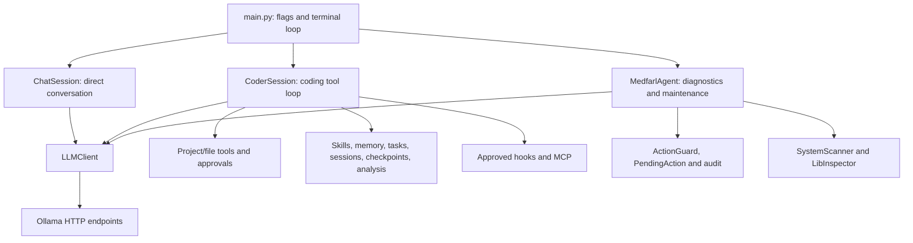

# Technical documentation

Implementation snapshot: **2026-10-24**. This describes the current source tree,
including the coding extensions. Historical releases are recorded in the changelog.

## Architecture



`main.py` selects direct chat unless `--coder`, `--agent`, diagnostic unsafe access,
or the coder-implying `--prompt`/`--plan`/`--resume` flags select another path.
`--agent` and `--coder` are mutually exclusive. Coder-specific flags reject `--agent`.
`/coder [path]` opens a nested coder from the outer terminal loop; returning preserves
the original chat object.

Startup can ensure Ollama is reachable, preload the model and run preflight.
`--no-warmup` and `--skip-healthcheck` control those separately. A new coder
workspace is offered for creation before startup completes. No model pull is automatic.

## Module ownership

| Module | Responsibility |
| --- | --- |
| `config.py` | Environment-backed diagnostic/chat settings and model defaults |
| `main.py` | Arguments, startup, mode selection and outer REPL |
| `ui/cli.py` | Console encoding, diagnostic banner and input |
| `core/llm_client.py` | Completion requests/SSE and Ollama preload/model APIs |
| `core/chat.py` | Direct history, completed-turn recording and reset |
| `core/coder.py` | Coding tools, workspace/access controls, dispatch, approvals, commands and coder REPL |
| `core/project_templates.py` | Python/web/empty manifests |
| `core/coder_extensions.py` | Skills/rules, memory, tasks, persistence, compaction, checkpoints and analysis agents |
| `core/coder_integrations.py` | MCP transports/lifecycle and approved command hooks |
| `core/agent.py` | Diagnostic classification, planner/tool loop, guided responses and pending actions |
| `core/system_scanner.py`, `core/lib_inspector.py` | System/process/package/service observations |
| `core/action_guard.py`, `core/approval.py`, `core/audit.py` | Diagnostic path/command checks, single-pending state and JSONL events |
| `core/file_ops.py`, `core/program_runner.py`, `core/package_manager.py`, `core/antivirus.py` | Diagnostic maintenance |
| `tools/tools.py`, `tools/maintenance_tools.py`, `tools/antivirus_tools.py` | Diagnostic tool registration |
| `tools/mcp_echo_server.py` | Explicitly started local MCP demonstration server |
| `skills/*/SKILL.md` | Original bundled coding workflows |

Coder and diagnostic execution are separate. Diagnostic root/confirmation settings
and its pending-action mechanism do not configure coder approvals.
The complete diagnostic registration/parameter index is in [DIAGNOSTICS.md](DIAGNOSTICS.md).

## LLM transport

The backend URL is a root such as `http://localhost:11434`, without `/v1`.

| Endpoint | Use |
| --- | --- |
| `POST /v1/chat/completions` | Nonstreaming and streaming chat/tool requests |
| `GET /api/tags` | Reachability, model listing and preflight |
| `POST /api/generate` | Empty-prompt Ollama preload and optional keep-alive |

`LLMClient.chat(messages, tools=None, stream=False, reasoning_effort=None)` returns
`assistant_message` plus legacy first-call fields `tool_call`/`tool_call_id`.
When present, `tool_calls` preserves the full collection for the coder. SSE
fragments are accumulated by tool index before arguments are decoded. Text is
printed incrementally; reasoning-only fields are not presented as an answer.

Preflight checks model availability and, when required, whether the endpoint
accepts a tool-bearing request. It does not guarantee reliable model tool choice.
The diagnostic agent retains the first-call contract; the coder consumes all calls
and records a result for every call ID.

A non-Ollama backend may support chat but lack model/preload endpoints. Use an
explicit model and `--no-warmup --skip-healthcheck` when appropriate; this does not
guarantee provider compatibility. `/model` and model listing use Ollama APIs.

## Conversation and coding turns

Direct `ChatSession` has no tools. It records a user/assistant pair only after a
nonempty completed reply, retains up to 40 history messages by default, and avoids
starting a trimmed history on an orphan assistant reply. `/reset` clears it.

A coder turn:

1. Resets temporary skill restrictions, activates an explicitly selected skill,
   and records the user message.
2. Filters tool schemas by plan/analysis mode and skill restrictions.
3. Rebuilds project/rule/memory/skill metadata context and sends the history.
4. For every call, rechecks availability/argument names, runs eligible pre-hooks,
   executes the approved tool, then runs eligible post-hooks.
5. Records all call/result pairs, including failed, blocked or interrupted calls.
6. Continues until a final reply, refusal, or the default 20-step limit.

An empty final reply after tool activity receives an evidence-based summary of
actual results. A denial stops the turn; completed actions remain. Post-hook failure
reports that the underlying action already completed. Temporary skill restrictions
clear even when requests fail or are interrupted.

Coder history has no automatic token compaction. `/compact` asks the local model
for a summary without tools, keeping the original history on failure. The stored
summary is capped at 10,000 characters; tasks and file tracking are retained.

## Coding tool contracts

| Tool | Contract |
| --- | --- |
| `list_files` | Permitted directory; skips Git/dependency/cache directories; up to 1,000 names |
| `read_file` | `path`, optional 1-based `start_line`, `max_lines`; numbered text, total lines, truncation flag and complete-content SHA-256; at most 400 returned lines |
| `search_text` | Literal case-insensitive search; optional directory; up to 100 matches with 500-character line snippets |
| `git_info` | Fixed status, diff against HEAD, or last 10 log entries; 32,000 returned bytes; no general shell |
| `write_file` | New UTF-8 content; existing file needs current `expected_sha256` |
| `replace_text` | Exactly one nonempty `old_text` occurrence, with preview and conflict check |
| `create_directory` | Approved parent/directory creation; existing directory is a no-op |
| `edit_files` | Array of path/content/optional expected hash; validates the whole set first |
| `create_project` | New directory; empty/python/web template or custom relative manifest |
| `run_command` | Approved shell/command/cwd/timeout; bounded returned output |
| `load_skill`, `read_skill_file` | Eligible skill body or confined supporting file of an active skill |
| `remember` | Approved note append to `.medfarl/memory.md` |
| `update_tasks` | Replace up to 50 in-memory title/status items |
| `delegate` | Isolated, sequential, read-only analysis with a six-step limit |
| `mcp__server__tool` | Dynamic remote schema; separate approval for every call |

Text operations accept UTF-8 files up to **512 KiB** and reject NUL-bearing files.
Batches accept **1–32 files**, **2 MiB** total. Duplicate/overlapping targets,
outside-project traversal and `.git` internals are rejected by normal file tools.
Project manifest paths must be internal and relative.

Hashes cover complete content even when a read returns only a range. Full rewrites
must reconstruct the whole file. Snapshots are rechecked after approval. Writes
replace a temporary file in the target's parent, preserving its existing mode.
Each file is atomic; the batch is not one filesystem transaction. Earlier writes
remain on an I/O error, and completed paths are reported.

Commands default to PowerShell; CMD/sh are available when installed. Timeouts are
clamped to **1–300 seconds**. Output is spooled to a temporary file; up to **16,000
bytes** return with exit/timeout/truncation fields. Timeout/interruption terminates
the process tree/group. Commands are not sandboxed.
Read-only Git disables external diff/textconv, filesystem monitors, clean/process
filters, signature display and lazy fetching.

## Permission boundaries

| Runtime | Read scope | Mutation policy |
| --- | --- | --- |
| Coder edit | Workspace; expansion through approved `/access full` | Diff and command/MCP/hook approvals remain required |
| Coder plan | Permitted reads and fixed Git inspection | File/state writes, shell, hooks and MCP calls blocked by implementation checks |
| Analysis child | Parent workspace, fresh conversation | No shell, hooks, MCP, nested delegation or writes |
| Diagnostic guarded | Configured read/edit/exec roots | One pending mutation; diagnostic confirmation flags |
| Diagnostic unsafe | Expanded local drive roots | Diagnostic confirmation flags disabled |

`MEDFARL_CONFIRM_*` and `MEDFARL_UNSAFE_FULL_ACCESS` settings belong to diagnostics;
they do not bypass coder approvals. Approved commands, hooks and MCP processes have
the OS user's privileges. Path checks are not an OS sandbox; administrator
elevation is separate.

Skill `allowed-tools` is an intersection, never a permission grant. Dispatch blocks
disallowed model calls and rejects undeclared private native arguments. Hooks
cannot approve another action. The model's instructions do not override these checks.

## Skills, rules and memory

See [CLAUDE_COMPATIBILITY.md](CLAUDE_COMPATIBILITY.md) for discovery precedence,
frontmatter fields, invocation, examples and rejected compatibility features.

Skill metadata enters the catalog; bodies enter on invocation/`load_skill`.
`yaml.safe_load` parses frontmatter. Markdown inputs are capped at 128 KiB.
Supporting reads stay inside the active skill's resolved directory. Shell
substitutions are not evaluated.

Root AGENTS/QWEN/GEMINI files load in the coder. Extensions add root/nested CLAUDE
files, project memory and `.claude/rules`. Nested/path-scoped guidance loads after
relevant reads. Matching uses Python-style patterns plus a zero-directory `**/`
fallback, not full Claude glob semantics. Context snippets are bounded; explicit
file tools can read further content.

Notes are 1–8,000 characters and require a diff approval. Tasks use `pending`,
`in_progress` or `completed` and titles up to 500 characters. No background
automatic memory writer runs.

## Session and checkpoint storage

Local JSON uses schema **version 1**. Names are 1–64 ASCII letters/digits,
underscores/hyphens. The state-file limit is **8 MiB**.

| Location | Contents |
| --- | --- |
| `.medfarl/memory.md` | Approved project notes; shareable by user choice |
| `.medfarl/sessions/<name>.json` | Workspace/model metadata, timestamp, history, tasks, plan mode, original contents and last-written hashes |
| `.medfarl/checkpoints/<name>.json` | Workspace and tracked content snapshots |
| `medfarl_actions.log` | Diagnostic JSONL audit when enabled |
| `junk_quarantine/` | Diagnostic quarantine data |

State writes use a temporary file and confirmation, without joining the file-edit
journal. There is no automatic save or encryption. Git ignores sessions/checkpoints
in this repository and starter templates, but not project memory.

Resume validates workspace/schema and user/assistant/tool role/call pairing,
asks before replacing history, restores tasks/file baselines, retains the selected
model and revokes full access. Saved tool calls are not executed.

Checkpoints contain file-tool-tracked paths, not a whole project snapshot. Rewind
can restore content and remove newly created files after an approved diff. Current
hashes must match the last tool write; external edits block it. Directories and
shell/Git effects are not restored. Multi-file restores can report partial completion.

## MCP and hooks

MCP config: `.mcp.json` and `.medfarl/mcp.json`, under `mcpServers`. Only explicit,
approved `/mcp connect name` opens a connection. Use command/args/env for stdio or
URL/headers for HTTP. `${ENV_NAME}` expands at connection time; missing values fail.

The client supports protocol **2025-03-26**, initialize/initialized, paginated tool
listing and tool calls. Stdio uses newline-delimited JSON-RPC and a bounded queue.
HTTP handles JSON/response SSE and retains `Mcp-Session-Id`. Default request timeout
is 20 seconds, with 2 MiB message/response caps. Listing is limited to five pages
and 100 definitions. Connections close on workspace switch/exit. Other negotiated
versions are rejected.

OAuth, resources/prompts, sampling, elicitation, legacy SSE endpoints and background
reconnection are unsupported. The bundled echo server provides a local end-to-end demo.

Command-only `PreToolUse`/`PostToolUse` hooks load from the hooks blocks in
`.claude/settings.json` and `.medfarl/settings.json`. Matchers use regexes over
native Medfarl tool names. Event JSON arrives on stdin. Each hook uses the normal
command approval/runner; configured timeout is capped at 60 seconds. Hooks are
disabled in plan/analysis and skills that do not permit shell.
Nonzero/denied pre-hooks block actions. Post-hook failure cannot undo a completed
action and reports that fact. Other lifecycle types and imported Claude permission
rules are not applied.

## Configuration reference

Settings load in `config.py` at import time except the coder override read by the CLI.

| Environment setting | Default | Meaning |
| --- | --- | --- |
| `MEDFARL_LLM_URL` | `http://localhost:11434` | Backend root |
| `MEDFARL_MODEL` | `tripolskypetr/qwen3.5-uncensored-aggressive:4b` | Shared default |
| `MEDFARL_CODER_MODEL` | Shared default | Coder override; `--model` wins |
| `MEDFARL_TIMEOUT` | `120` | Model request seconds |
| `MEDFARL_KEEP_ALIVE` | `30m` | Ollama preload keep-alive |
| `MEDFARL_AUTOSTART_OLLAMA` | `1` | Start Ollama if unavailable |
| `MEDFARL_WARMUP` | `1` | Preload at startup |
| `MEDFARL_CHAT_SYSTEM_PROMPT` | Built-in | Direct chat prompt |
| `MEDFARL_CHAT_REASONING_EFFORT` | `none` | Direct chat parameter |
| `MEDFARL_MAX_TOOL_STEPS` | `8` | Diagnostic step limit; coder default is separately 20 |
| `MEDFARL_ALLOWED_READ_ROOTS` | Process cwd | Diagnostic reads |
| `MEDFARL_ALLOWED_EDIT_ROOTS` | Process cwd | Diagnostic writes |
| `MEDFARL_ALLOWED_EXEC_ROOTS` | Process cwd | Diagnostic execution |
| `MEDFARL_CONFIRM_EXEC` | `1` | Diagnostic execution confirmation |
| `MEDFARL_CONFIRM_DELETE` | `1` | Diagnostic delete confirmation |
| `MEDFARL_CONFIRM_PACKAGE_CHANGES` | `1` | Diagnostic package confirmation |
| `MEDFARL_CONFIRM_FILE_EDITS` | `1` | Diagnostic edit confirmation |
| `MEDFARL_ENABLE_ACTION_LOG` | `1` | Diagnostic JSONL enabled |
| `MEDFARL_ACTION_LOG_PATH` | `cwd/medfarl_actions.log` | Audit location |
| `MEDFARL_JUNK_QUARANTINE_DIR` | `cwd/junk_quarantine` | Quarantine root |
| `MEDFARL_UNSAFE_FULL_ACCESS` | `0` | Legacy diagnostic unsafe mode |

Lists use `os.pathsep`: `;` on Windows, `:` on Unix. True flag values: `1`, `true`,
`yes`, `y`, `on`. Coder workspace comes from `--workspace` or process cwd, not the
diagnostic root variables. `python main.py --help` is the CLI reference.

## Verification and contribution

```powershell
python -m unittest discover -s tests -v
python -m unittest tests.test_coder_extensions -v
python main.py --coder --no-warmup --healthcheck
```

Unit tests use model fixtures/mocks. Some run short local shells, Git in a temporary
repository and a temporary stdio MCP server. HTTP JSON/SSE uses
`httpx.MockTransport`. Only the optional model/healthcheck path requires Ollama.

| Suite | Coverage |
| --- | --- |
| `test_chat_routing.py`, `test_unsafe_mode.py` | Diagnostic routing and unsafe tools/shell |
| `test_direct_chat.py` | Chat history and default startup |
| `test_coder.py` | File conflicts, scope, commands/timeouts, fragmented streaming |
| `test_coder_projects.py` | Templates, custom manifests, batch conflicts, workspace switching |
| `test_coder_extensions.py` | Skills, plans, rules/memory, sessions/rewind, analysis, hooks, one-shot CLI and MCP |

Verification on 2026-10-24: **80 tests, 79 passed, 1 Windows symlink test skipped**.
Manual checks covered configured Qwen 9B tool use, generated Python tests, plan-only
reading, session restoration, terminal flow and the local MCP echo server. Other
models, OSes and authenticated external providers have not all been verified.
Historical `scripts/smoke_*` checks target diagnostics; inspect their assumptions
and filesystem effects before using them on a real workspace.

Register a new coding tool in `CoderSession._tools`, preserve dispatch availability
checks, and guard mutation implementations with `_require_edit`. Add a tool to
`READ_TOOLS` only when it has no general-command/external-action path. Test denial,
plan mode, scope, concurrent changes and partial failures where applicable.
Diagnostic tools are separately registered under `tools/` and retain the
pending-action/audit contract.
